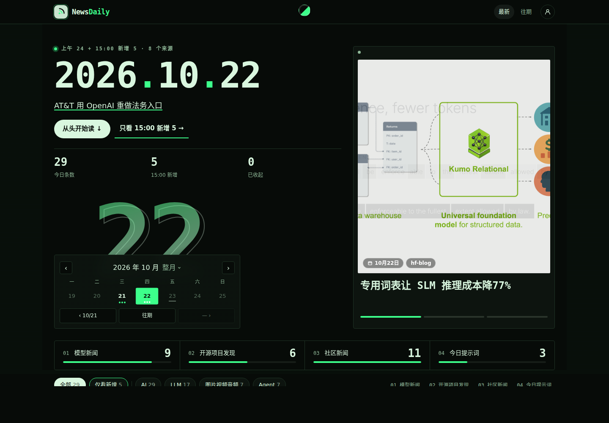
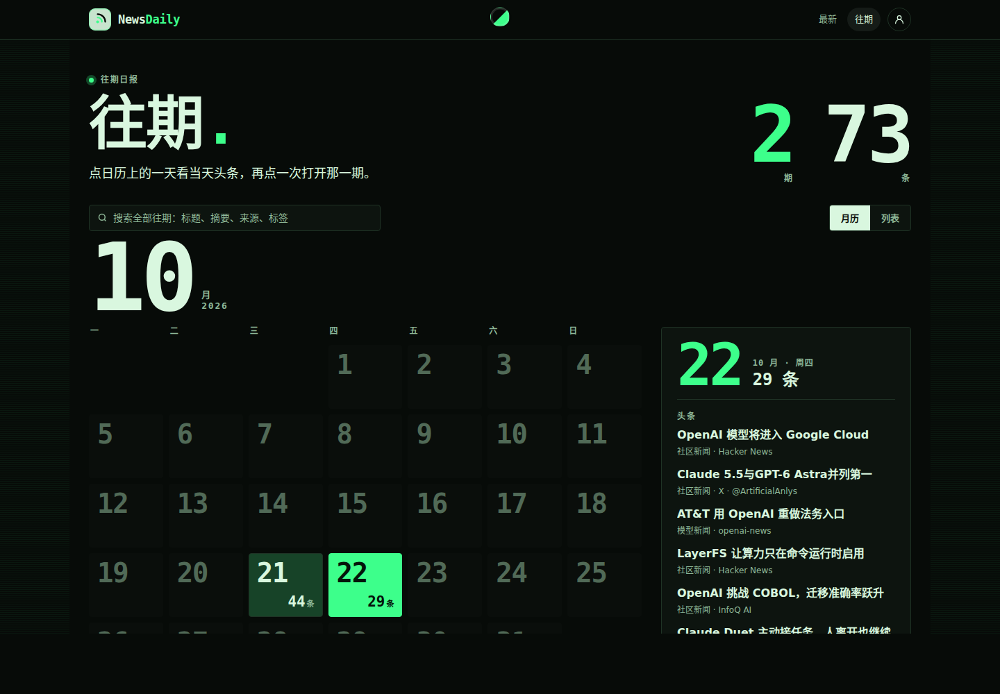
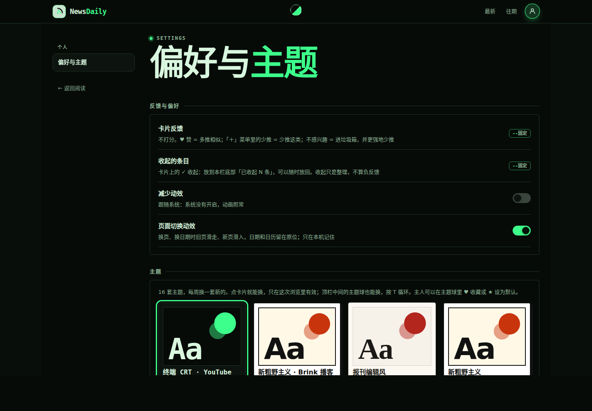

<div align="center">

# newsp

**个人用的每日 AI 新闻站。** 每天早上一期完整日报，15:00 / 20:00 各追加一次增量；规则打分、去重、配额全部是确定性的，AI 只负责用你自己的模型 Key 写中文标题和摘要。跑在 Cloudflare Workers + D1 上，一键部署。

[](https://github.com/lthero-big/newsp/actions/workflows/test.yml)
[](LICENSE)


[](https://deploy.workers.cloudflare.com/?url=https://github.com/lthero-big/newsp)

[功能](#功能) · [截图](#截图) · [快速开始](#快速开始) · [文档 Wiki](https://github.com/lthero-big/newsp/wiki) · [部署](https://github.com/lthero-big/newsp/wiki/Deployment) · [出刊](https://github.com/lthero-big/newsp/wiki/Editions) · [常见问题](https://github.com/lthero-big/newsp/wiki/FAQ)

</div>

*newsp is a personal, single-owner daily AI news site: a full edition every morning plus two incremental runs, deterministic rule scoring / dedupe / quotas, optional Chinese titles and summaries written by your own LLM key (14 provider presets or any OpenAI-compatible endpoint, plus a fallback), a static site with an owner-only layer (likes, favorites, trash, preference learning, source weights, read-only MCP) on Cloudflare Workers + D1. Editions run on GitHub Actions or your own machine. MIT licensed.*

> 从 [news-daily](https://news.lthero.com) 派生的干净版本：不带历史、数据和密钥，也不依赖任何特定的 bot 或代理服务。多用户、自托管的版本见姊妹项目 [newsd](https://github.com/lthero-big/newsd)。

## 功能

**日报**
- 每天北京时间 08:30 一期完整日报，15:00、20:00 各追加一次增量（只加新条目，页面上可以「只看新增」）。
- 三个模块：模型新闻 / 开源项目发现 / 社区新闻；四个标签：AI / LLM / 图片视频音频 / Agent。
- 打分、去重（含跨期去重）、每个模块的配额都是确定性规则，不用 AI；保存的抓取结果可以用 `--replay` 重新打分。
- 静态页面：首屏大号日期和当期导语、日历翻看往期、往期搜索（标题 / 摘要 / 来源 / 标签）、手机底部标签栏；每周一套固定外观（`editions/`），可在设置页切换主题。

**信息源**
- Hacker News、Reddit、RSS / Atom（官方博客、GitHub releases）、GitHub 新仓库、Hugging Face 热门、OSSInsight 趋势、Arena 榜单。
- 可选：经你自己部署的 RSSHub 接入 X（账号时间线 + 关键词搜索）和任意 RSSHub 路由。
- 默认源目录在 [`config/collect-sources.json`](config/collect-sources.json)；上线后在「订阅源」页按类别开关、调权重（−1…+2），下一期生效。

**中文文案（可选）**
- 用你自己的 Key：内置 OpenAI、Anthropic、Gemini、xAI、Mistral、Groq、OpenRouter、DeepSeek、通义、智谱、Kimi、豆包、硅基流动、Ollama 预设，或任意 OpenAI 兼容地址。
- 可配一个备用模型，主用失败（429 / 5xx / 超时）时自动切换。不配模型也能出刊，卡片显示原标题。

**主人功能（口令解锁）**
- ♥ 点赞（多推）、少推 / 删除（进垃圾箱，可恢复）、收藏；偏好学习会影响下一期排序，在设置页能看到学到了什么。
- 收藏页、垃圾箱、订阅源管理、主题设为默认。
- 只读 MCP（`/mcp`，令牌在 `/mcp-admin` 生成）：`search_news`、`get_item`、`list_favorites`、`list_filters`、`list_sources`。
- 可选的「深挖这条 / 自由指令」webhook：把卡片 JSON POST 给你自己的 agent 或自动化（每天最多 20 次）。
- 口令错误 3 次锁定该 IP 15 分钟；全站 `noindex`。

**出刊与推送**
- 出刊跑在 GitHub Actions（定时 + 手动，可选只出预览分支）或你自己的机器（cron / Docker / self-hosted runner）。
- 发布前可跑快检（手机布局 + 不变量，GitHub Actions 默认开启），失败不发布；完成后推送摘要到 Telegram、通用 Webhook、Bark 或 Server 酱。

## 截图

| 每日日报 | 往期 |
| --- | --- |
|  |  |
| **偏好与主题** | **手机端** |
|  |  |

截图用仓库自带的示例日报（`examples/data/`）构建。

## 快速开始

### 一键部署到 Cloudflare

1. 点上面的 **Deploy to Cloudflare**，登录 Cloudflare 并授权 GitHub；Cloudflare 会把本仓库复制到你的账号下并连到一个新 Worker。
2. 确认 Worker 名（默认 `newsp`）和 D1 数据库名（默认 `newsp-state`，自动创建），填 `RATINGS_TOKEN`（主人口令，例如 `openssl rand -hex 24`）。构建命令 `npm run build`、部署命令 `npm run deploy` 保持默认。
3. 部署完成后打开 `https://newsp.<你的子域>.workers.dev`。还没出过刊时站点显示示例日报。

然后配置出刊（GitHub Actions 或自己的机器），见 Wiki 的 [出刊](https://github.com/lthero-big/newsp/wiki/Editions) 页。手动连接、命令行部署、自定义域名见 [部署](https://github.com/lthero-big/newsp/wiki/Deployment)。

### 本地预览

需要 Node 22 和 Python 3.11+：

```bash
git clone https://github.com/lthero-big/newsp.git && cd newsp
npm ci
python3 -m pip install -r requirements.txt   # 可选依赖（图片尺寸、正文抽取、Arena parquet）
npm test
cp .dev.vars.example .dev.vars               # 本地主人口令（不要提交 .dev.vars）
npm run dev                                  # 构建 + 本地 D1 迁移 + wrangler dev（站点 + 接口）
```

在本地跑一期（只生成，不发布）：

```bash
mkdir -p ~/.config/newsp && cp deploy/env.example ~/.config/newsp/env && chmod 600 ~/.config/newsp/env   # 填好模型等配置
bash scripts/run-edition.sh am --tests none
```

## 文档

完整文档在 [GitHub Wiki](https://github.com/lthero-big/newsp/wiki)：

- [架构](https://github.com/lthero-big/newsp/wiki/Architecture)：出刊流水线、Worker 路由、D1 表
- [部署](https://github.com/lthero-big/newsp/wiki/Deployment)：一键部署、手动连接 fork、命令行、自定义域名、预览分支
- [出刊](https://github.com/lthero-big/newsp/wiki/Editions)：GitHub Actions、自托管 cron / Docker、`run-edition.sh` 参数、推送
- [配置](https://github.com/lthero-big/newsp/wiki/Configuration)：环境变量、模型、RSSHub / X、Worker secrets
- [使用](https://github.com/lthero-big/newsp/wiki/Usage)：主人解锁、反馈与偏好学习、订阅源、MCP、webhook
- [开发](https://github.com/lthero-big/newsp/wiki/Development) · [常见问题](https://github.com/lthero-big/newsp/wiki/FAQ)

Wiki 的源文件在 [`docs/wiki/`](docs/wiki/)，用 `scripts/publish-wiki.sh` 同步；设计规则见 [`docs/DESIGN-RULES.md`](docs/DESIGN-RULES.md)。

## 目录

| 路径 | 内容 |
| --- | --- |
| `scripts/run-edition.sh` | 一期的完整流程：X → 抓取 / 打分 / 去重 / 学习 → 中文文案 → 构建 → 测试 → 发布 / 预览 → 摘要 |
| `scripts/collect/` | 抓取插件、规则打分（`generate.py`）、偏好学习（`learning.py`）、X / RSSHub |
| `scripts/llm.py` | 中文文案（服务商预设 + 备用模型） |
| `scripts/build.mjs` · `site/` | 静态站生成器和前端 |
| `src/worker.js` · `functions/` | Worker 入口和接口（`/api/*`、`/mcp`） |
| `migrations/` | D1 迁移，部署时自动执行 |
| `config/` · `themes/` · `editions/` | 信息源、标签、提示词；主题和每周外观 |
| `examples/data/` | 示例日报（`data/` 为空时用于构建和测试） |

## 许可

[MIT](LICENSE)。
