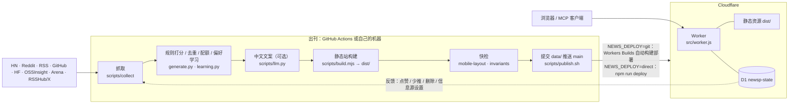

# 架构

## 出刊流水线

一期由 `scripts/run-edition.sh am|pm` 完成，本机、Docker 和 GitHub Actions 跑的是同一个脚本：

1. **X（可选）**：设置了 `RSSHUB_BASE` 时，`scripts/collect/x_standby.py` 抓 RSSHub 上的 X 账号时间线和关键词搜索，规则过滤后再用模型做一次相关性判断（`NEWS_X_SCORE=0` 关闭）。
2. **抓取 + 打分**（`scripts/daily.sh`）：先用 `scripts/sync-state.mjs` 从线上接口拉主人反馈，再抓取 → 规则打分（`generate.py`，不用 AI）→ 补全 → 校验（`schema/daily.schema.json`）→ 构建。`pm` 是增量：保留早间条目，只追加新条目，重复跑是幂等的。
3. **中文文案**（`NEWS_LLM=key`，默认）：`scripts/llm.py` 给卡片写中文标题和摘要；没写全的卡片显示原标题。
4. **构建 + 测试**：`scripts/build.mjs` 生成 `dist/`，默认跑快检（手机布局 + 不变量）。
5. **发布**：`scripts/publish.sh` 提交 `data/` 推送 `main`，按 `NEWS_DEPLOY` 上线；或 `--preview edition/<x>` 只推预览分支。
6. **摘要**：打印本期摘要，`scripts/notify/notify.sh` 推送到已配置的渠道。

## 站点：Worker + 静态资源 + D1

- `wrangler.toml` 的 `[assets]` 指向 `dist/`，`run_worker_first = true`：每个请求先经过 Worker。
- `src/worker.js` 是一张显式路由表，处理函数在 `functions/` 里：

| 路径 | 文件 | 作用 |
| --- | --- | --- |
| （所有请求） | `functions/_middleware.js` | 旧的 `/<date>.html` 日报地址 301 到 `/<yyyy>/<mm>/<date>`；所有响应加 `X-Robots-Tag: noindex, nofollow` |
| `/mcp` | `functions/mcp.js` | 只读 MCP（Streamable HTTP，JSON 响应），Bearer MCP 令牌 |
| `/api/ratings` | `functions/api/ratings.js` | ♥ 点赞（多推）/ 少推、收藏 |
| `/api/deletions` | `functions/api/deletions.js` | 不感兴趣（删除）倒计时、垃圾箱、恢复、永久删除 |
| `/api/learned` | `functions/api/learned.js` | 学到的偏好（多推 / 少推的关键词），可逐条清除 |
| `/api/prefs` | `functions/api/prefs.js` | 主人偏好：收藏的主题、默认主题、首屏组件、减少动效 |
| `/api/reads` | `functions/api/reads.js` | 已读 ✓ / 收起状态，多设备同步 |
| `/api/sources` | `functions/api/sources.js` | 信息源设置和最近一次采集状态 |
| `/api/mcp-tokens` | `functions/api/mcp-tokens.js` | 生成 / 吊销 MCP 令牌 |
| `/api/agent-task` | `functions/api/agent-task.js` | 「深挖这条 / 自由指令」webhook 转发 |

其余请求交给静态资源（`dist/_headers` 里的 CSP 和缓存头生效，找不到的页面返回 `dist/404.html`）。

### D1 表（`migrations/`）

| 表 | 内容 |
| --- | --- |
| `ratings` | 收藏、点赞 / 少推、收藏时间 |
| `deletions` · `penalty_overrides` | 不感兴趣倒计时 / 垃圾箱状态；清除过的少推关键词 |
| `source_settings` | 信息源开关、权重和采集状态 |
| `reads` | 已读 ✓ |
| `owner_prefs` | 主人偏好（主题等），多设备同步 |
| `mcp_tokens` | MCP 令牌（只存 SHA-256） |
| `auth_fail` | 口令 / 令牌失败计数和 IP 锁定 |
| `agent_rate` | webhook 每日次数 |

迁移由 `npm run deploy`（`wrangler deploy && wrangler d1 migrations apply DB --remote`）每次部署自动补齐。

## 状态放在哪里

| 位置 | 内容 | 是否提交 |
| --- | --- | --- |
| `data/<date>.json` | 每期日报（schema 2.0） | 是，出刊时提交到 `main` |
| `data/state/` · `data/themes/` | 跨期去重索引、主题等 | 是 |
| `editions/` | 每周固定外观 | 是 |
| `lib/catalog.js` | 构建生成的 MCP 检索目录 | 是 |
| `var/` | 每次运行的抓取结果、已见条目、媒体缓存、日志 | 否（Actions 里用 `actions/cache` 保存） |
| D1 | 主人反馈和设置 | — |

`data/` 里还没有日报时，构建使用 `examples/data/` 的示例日报，第一期真实日报写入后就不再使用。
